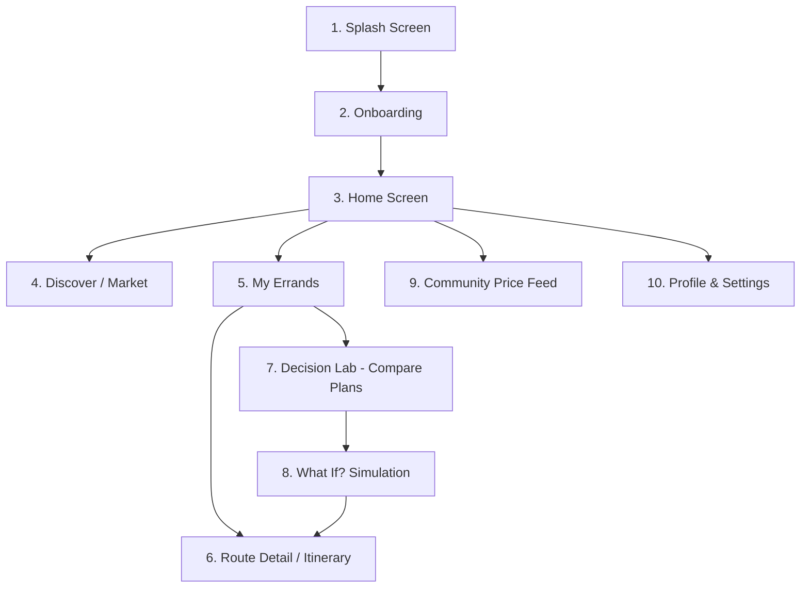

# SmartMove: Complete UI & User-Flow Specification

> **Design Reference:** Master UI Board [`ui_designs/smartmove_master_design_board.jpg`](./ui_designs/smartmove_master_design_board.jpg)  
> **Brand Slogan:** *"Know the Prices. Plan the Trip. Make the Better Decision. (Smarter choices, closer to home.)"*

---

## 1. Design System & Style Tokens

### 1.1 Color Palette
- **Primary Brand Green:** `#00875A` (Deep Emerald / Forest Accent for CTAs, active icons, brand accents)
- **Primary Dark Green:** `#073B29` / `#0D4834` (Splash screen gradient, brand headers)
- **Light Green Tint / Background:** `#E3FCEF` (Badges, active states, button secondary)
- **Surface / Background:** `#F8F9FA` (Clean modern light theme)
- **Card Background:** `#FFFFFF` (Elevated with soft neutral border `#E8ECE9` & subtle shadow)
- **Text Primary:** `#172B4D` / `#1A202C`
- **Text Secondary / Subtitles:** `#5E6C84` / `#718096`
- **Badge Colors:**
  - **Success Badge:** Background `#E3FCEF`, Text `#006644` (e.g. *Verified*, *Cheapest*, *Recommended*)
  - **Warning Badge:** Background `#FFFAE6`, Text `#FF8B00` (e.g. *Price +8%*, *Medium Priority*)
  - **Info Badge:** Background `#DEEBFF`, Text `#0052CC` (e.g. *Low Priority*, *Tips*)
  - **Error / High Priority Badge:** Background `#FFEBE6`, Text `#DE350B` (e.g. *High Priority*, *Deadline Exceeded*)

### 1.2 Typography
- **Font Family:** Plus Jakarta Sans / Inter (`GoogleFonts.plusJakartaSans`)
- **Scale:**
  - Heading Large (Splash / Welcome): 26–28sp Bold
  - Heading Medium (Screen titles): 20–22sp SemiBold / Bold
  - Section Headers: 16–18sp SemiBold
  - Body Text: 14sp Regular / Medium
  - Caption / Badges: 11–12sp SemiBold

### 1.3 Iconography
- Location Pin, Price (`₦`), Time Clock, Transport (Bus/Car), Market/Storefront, User Avatar, AI Assistant (Sparkle).

---

## 2. Information Architecture & Navigation

The application uses **GoRouter** with a 5-tab persistent bottom navigation bar:
1. **Home** (`/home`) — Dashboard, Today's Plan banner, quick stats, price changes, start trip CTA.
2. **Discover** (`/discover`) — Market intelligence, product price search, category filtering, seller comparisons.
3. **My Errands** (`/errands`) — Errand & shopping list organizer (Today, Upcoming, Completed), route optimizer preview.
4. **Decision Lab** (`/decision-lab`) — Signature simulation & rehearsal engine (Compare Plans, What If sliders, trade-off explanations).
5. **Community** (`/community`) — Community & trader verified price contributions, observation feed, `+` FAB report modal.

Sub-routes:
- `/splash` — Brand splash screen
- `/onboarding` — Value proposition walkthrough
- `/itinerary` — Detailed step-by-step turn-by-turn route breakdown
- `/profile` — Settings, wallet, saved items, data & privacy

---

## 3. Screen-by-Screen Specification

### Screen 1: Splash Screen
- **Visuals:** Deep forest green gradient (`#073B29`), brand logo (green shield with pin & shopping bag), skyline silhouette.
- **Content:**
  - App Name: **SmartMove**
  - Slogan: *"Know the Prices. Plan the Trip. Make the Better Decision."*
  - Value summary: Market Price Intelligence, Errand Coordinator, Decision Rehearsal Engine.
- **Actions:**
  - `Get Started` -> navigates to `/onboarding` (or `/home` if already onboarded).
  - `Log In` -> authentication modal/screen.

### Screen 2: Onboarding
- **Visuals:** Vibrant illustration of local market trader with produce and price analytics overlay.
- **Content:**
  - Title: *"Real Market Prices"*
  - Subtitle: *"Get the latest prices from local traders and community reports."*
  - 4-dot step pagination indicator.
- **Actions:**
  - `Next` -> steps through slides (Market Prices -> Errand Planner -> Decision Lab) -> `/home`.
  - `Skip` -> immediate jump to `/home`.

### Screen 3: Home ("Smarter plans for your day")
- **Header:** "Good morning, Gent 👋" + subtitle "Smarter plans for your day" + notification icon + user avatar.
- **Today's Plan Banner Card:**
  - Active itinerary pill: `3 errands • 2.5 hrs • ₦12,500`
  - Tap card -> navigates to `/itinerary`.
- **Quick Stat Metrics (3 cards):**
  - **Budget:** `₦15,000` (wallet icon)
  - **Saved:** `₦2,350` (green tag icon)
  - **Est. Time:** `2.5 hrs` (clock icon)
- **Recent Price Changes (Market Ticker):**
  - Rice (1kg): `₦1,650` (Market B) `[+8%]`
  - Eggs (crate): `₦5,200` (Market A) `[-5%]`
  - Tomatoes (1kg): `₦1,100` (Market C) `[+12%]`
  - `View all >` -> jumps to `/discover`.
- **"Plan your next trip" CTA Card:**
  - "Compare prices, group errands, and save money."
  - Button: `Start Planning` -> opens Errand creator / Decision Lab.

### Screen 4: Discover (Market Price Intelligence)
- **Header:** "Discover / Find the best prices near you"
- **Search Bar:** "Search for a product (e.g. rice, eggs...)"
- **Category Filter Chips:** Groceries (active), Electronics, Pharmacy, Others.
- **Filter Row:** Dropdown `Nearby (v)` and `Sort by: Cheapest (v)`.
- **Product Cards:**
  - **Rice (1kg):** `₦1,650` | Market B • 1.2 km | Badge: `Cheapest` (Green) | Updated 2h ago
  - **Eggs (crate):** `₦5,200` | Market A • 2.5 km | Updated 3h ago
  - **Tomatoes (1kg):** `₦1,100` | Market C • 3.1 km | Updated 1h ago
  - **Cooking Oil (1L):** `₦2,850` | Market B • 1.2 km | Updated 2h ago
- **Transparency Notice:** Bottom caption: *Demo Data — Prices are simulated for testing.*

### Screen 5: My Errands
- **Header:** "My Errands" + `+ Add Errand` button.
- **Filter Tabs:** `[Today]` | `[Upcoming]` | `[Completed]`.
- **Errand List Items:**
  1. **Buy groceries:** Rice, Eggs, Tomatoes, Cooking Oil | 9:00 AM | Badge: `Priority: High` (Red)
  2. **Collect package:** From Jumia Pickup Station | 11:00 AM | Badge: `Priority: Medium` (Orange)
  3. **Visit pharmacy:** Pharmacy Plus | 1:00 PM | Badge: `Priority: Medium`
  4. **Pay electricity bill:** PHCN Office | 3:00 PM | Badge: `Priority: Low` (Blue)
- **Optimized Route Summary Card (Floating Bottom):**
  - "Optimized Route: 3 stops • 2.5 hrs • ₦1,200 transport"
  - Mini route path visual
  - Button: `View Itinerary` -> `/itinerary`.

### Screen 6: Your Itinerary (Detailed Route & Timing)
- **Header:** "Your Itinerary / 3 stops • 2.5 hrs • ₦13,400 total"
- **Turn-by-Turn Route Timeline:**
  - **Start:** Your Location (9:00 AM)
  - **Stop 1:** Market B (Groceries) — 1.2 km • 45 min (9:20 AM - 10:10 AM) `[Best prices]`
  - **Stop 2:** Pharmacy Plus — 0.8 km • 20 min (10:30 AM - 10:50 AM)
  - **Stop 3:** Jumia Pickup Station — 1.5 km • 35 min (11:30 AM - 12:00 PM)
  - **End:** Home
- **Actions:**
  - `Start Navigation` (Primary Green) -> activates live checklist & tracking.
  - `+ Edit Plan` -> returns to Errands or Decision Lab.

### Screen 7: Decision Lab (Compare Plans)
- **Header:** "Decision Lab / Explore different plans and see the impact."
- **Segmented Control:** `[Compare Plans]` | `[What If?]` | `[Scenarios]`
- **Active Basket Header:** "Your Shopping List: Rice (2kg), Eggs (1 crate), Tomatoes (2kg), Cooking Oil (1L) + 1 errand"
- **Side-by-Side Candidate Plans:**
  - **Plan A (Cheapest Products - Recommended):**
    - Cost: `₦13,400` | Time/Stops: `2.5 hrs • 3 stops`
    - Badge: `Recommended` (Green)
    - Trade-off: *Lowest total expenditure, visits 2 markets.*
  - **Plan B (Less Transport):**
    - Cost: `₦13,800` | Time/Stops: `1.8 hrs • 2 stops`
    - Trade-off: *Saves 42 mins travel time, costs ₦400 more for items.*
  - **Plan C (Fastest):**
    - Cost: `₦14,200` | Time/Stops: `1.2 hrs • 2 stops`
    - Trade-off: *Express single-destination run.*
- **Action:** `Adjust My Preferences` -> opens What If? tab.

### Screen 8: What If? (Scenario Simulation)
- **Header:** "What If? / Change a factor and see how it affects your plan."
- **Interactive Parameter Sliders:**
  - **Budget:** `₦15,000` (Range: ₦5,000 – ₦30,000)
  - **Transport Cost:** `₦1,200` (Range: ₦500 – ₦5,000)
  - **Time Available:** `3 hrs` (Range: 1 hr – 6 hrs)
- **Dynamic Result Box:**
  - "Best: Plan B -> ₦13,800 • 1.8 hrs • 2 stops" + `Update` button.
- **AI Recommendation / Trade-off Insight:**
  - *"💡 If your budget was ₦12,000, we'd suggest removing tomatoes or buying from a single market."*

### Screen 9: Community (Local Price Intelligence)
- **Header:** "Community / Real people. Real prices. Stronger together."
- **Tabs:** `[Recent Prices]` | `[My Contributions]`
- **Community Post Cards:**
  - **Mama Bello (Trader)**, Market B • 2h ago: Rice (1kg) `₦1,650` `[Verified by Trader]`
  - **Emeka (Customer)**, Market C • 3h ago: Tomatoes (1kg) `₦1,100` `[Verified by community]`
  - **Tunde (Trader)**, Market A • 4h ago: Eggs (crate) `₦5,500` `[Verified by Trader]`
- **Action:** Floating Action Button `+` -> opens "Submit Price Observation" form modal.

### Screen 10: Profile & Settings
- **User Profile:** Gent (`gent@example.com`), initial avatar `G`.
- **Options List:**
  - My Wallet (`₦15,000`)
  - Saved Items (`12`)
  - Saved Locations (`5`)
  - Notifications (Interactive Switch)
  - Language (`English`)
  - Data & Privacy
  - Help & Support
  - About SmartMove

---

## 4. Implementation Plan for Flutter Codebase

1. **Theme & Design System:**
   - Configure `lib/core/theme/app_colors.dart` and `app_theme.dart` using the exact emerald palette (`#00875A`, `#073B29`, `#F8F9FA`, status badges).
2. **State Management & Data Layer:**
   - Riverpod providers for `MarketPriceNotifier`, `ErrandPlannerNotifier`, `DecisionLabNotifier`, and `UserPreferencesNotifier`.
   - Seed realistic demo data strictly labeled as simulated for testing.
3. **Deterministic Arithmetic:**
   - Calculations for item costs, transit fares, duration, and constraint evaluation (budget, 2:00 PM package deadline) kept authoritative in Dart.
4. **Interactive Navigation:**
   - Complete GoRouter setup linking all 10 screens and bottom navigation bar.
